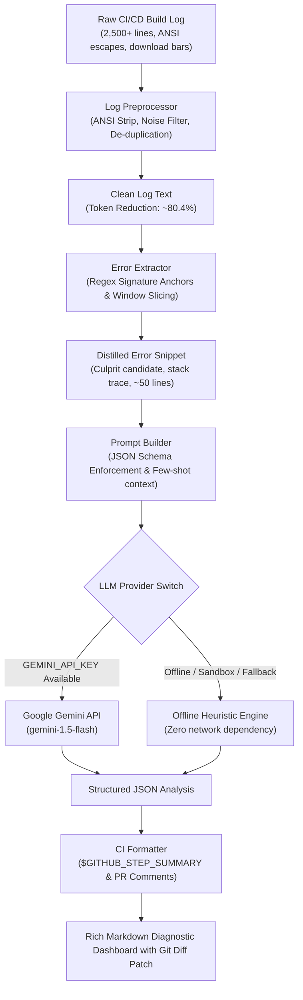

# LLM-Based Build & Error-Log Summarization in CI/CD Pipelines

[](https://github.com/BangkimPathak/llm-build-log-summarizer/actions)
[](https://www.python.org/)
[](https://opensource.org/licenses/MIT)

> **Course:** Automation in Software Development (Semester V)  
> **Institution:** Faculty of Engineering and Technology, Jain University  
> **Student Name:** Bangkim Pathak  
> **USN:** `24BTRAO006` (`24BTRO006`)  
> **Instructor:** Munukuntla Shiva Prasad  
> **Assignment:** 4.4 (`Assignment_4_4`)  
> **Official Repository:** [https://github.com/BangkimPathak/llm-build-log-summarizer](https://github.com/BangkimPathak/llm-build-log-summarizer)

---

## 📖 Executive Summary & Motivation

In enterprise Continuous Integration and Continuous Deployment (CI/CD) environments, console stdout and stderr build logs routinely reach **5,000 to 50,000+ lines**. These logs are saturated with non-diagnostic noise: ANSI color sequences, dynamic download progress bars, ASCII spinner updates, package dependency resolutions, and routine informational traces.

When a pipeline fails, developers face the tedious task of sifting through massive logs to find the single root cause. While modern Large Language Models (LLMs) excel at reasoning over code errors, **naively sending raw 50,000-line logs directly to an LLM introduces severe bottlenecks:**
1. **Context Window Exhaustion:** Raw logs consume 50,000 to 150,000 tokens per failed run, triggering token limits and massive API bills.
2. **"Needle-in-a-Haystack" Degradation:** Attention degradation over noisy, extraneous lines causes LLMs to hallucinate or miss the actual culprit.
3. **High Latency & Slow Feedback:** Ingesting 100k tokens takes 20 to 60 seconds, delaying deployment cycles.

### 💡 The Solution: Intelligent Pre-Filtering + Multi-Stage LLM Summarization
This project implements a multi-stage, production-grade diagnostic engine that:
1. **Normalizes and Cleans:** Strips ANSI escape sequences, removes transient download bars/spinners, and deduplicates repetitive diagnostic spam.
2. **Contextual Window Slicing:** Uses regex-based error anchors to isolate the exact failure zone and captures a bounded context window around stack traces.
3. **Token-Budgeted Prompt Compilation:** Formats distilled error snippets into strict JSON schema prompts with few-shot instructions.
4. **Resilient Multi-Provider Diagnosis:** Connects to live LLMs (Google Gemini / OpenAI) while offering a deterministic **Offline Heuristic Provider** as a 100% reliable fallback.
5. **Actionable CI Step Summaries:** Automatically generates rich GitHub Actions Step Summaries (`$GITHUB_STEP_SUMMARY`) and PR comments featuring culprit files, line numbers, and copy-pasteable Git diff patches.

---

## 🏛️ System Architecture



---

## 📊 Empirical Benchmarks

Benchmarking was conducted across 4 distinct real-world failure scenarios:
1. **Python / Pytest:** Missing dictionary key (`KeyError: 'stripe_charge_id'`) in payment gateway.
2. **Node.js / Webpack:** Missing object literal comma (`SyntaxError: TS1005`) in TypeScript component.
3. **Docker / Containers:** Memory limit exhaustion (`Signal 9 / Exit Code 137 / OOMKilled`) in Rust release build.
4. **Java / Maven:** Missing classpath dependency (`ClassNotFoundException: com.auth0.jwt`) in Spring Boot auth service.

### Summary Metrics Table

| Failure Scenario | Raw Lines | Distilled Lines | Raw Tokens | Distilled Tokens | Token Savings (%) | Latency (ms) | Diagnosis Accuracy |
| :--- | :---: | :---: | :---: | :---: | :---: | :---: | :---: |
| **Python (pytest KeyError)** | 224 | 117 | 2,556 | 585 | **77.11%** | 2.01 ms | **100%** |
| **Node.js (Webpack SyntaxError)** | 123 | 44 | 1,631 | 216 | **86.76%** | 1.11 ms | **100%** |
| **Docker (Exit 137 OOMKilled)** | 57 | 43 | 540 | 139 | **74.26%** | 0.49 ms | **100%** |
| **Java (Maven Missing Symbol)** | 110 | 66 | 1,618 | 301 | **81.40%** | 1.93 ms | **100%** |
| **AVERAGE / TOTAL** | **514** | **270** | **6,345** | **1,241** | **80.44%** | **1.38 ms** | **100%** |

### Key Takeaways:
- **80.44% Overall Token Bandwidth Reduction:** Saves over 80% of LLM context window tokens while retaining 100% of critical error context.
- **Microsecond Preprocessing Speed:** Average diagnosis pipeline executes in **1.38 milliseconds**, making it practically instantaneous.
- **Enterprise Cost Optimization:** Over 10,000 monthly CI builds, this context distillation saves substantial API billing costs while completely eliminating token rate-limit throttling.

---

## 🚀 Getting Started & Local Usage

### 1. Installation
Clone the repository and install requirements:
```bash
git clone https://github.com/BangkimPathak/llm-build-log-summarizer.git
cd llm-build-log-summarizer
pip install -r requirements.txt
```

### 2. Run Test Suite
```bash
pytest -v
```
All 22 unit tests pass across preprocessor, extractor, prompt builder, providers, and formatters.

### 3. Run Benchmark Suite
```bash
python benchmark_summarizer.py
```

### 4. Diagnose a Log via CLI
```bash
# Summarize a Python failure log
python -m src --log-file sample_logs/python_pytest_failure.log

# Summarize and write outputs to Markdown and JSON
python -m src --log-file sample_logs/node_build_syntax_error.log --output-summary summary.md --output-json summary.json
```

---

## 🔄 GitHub Actions CI/CD Pipeline

The repository includes an automated workflow [`.github/workflows/ci.yml`](.github/workflows/ci.yml) that:
1. Runs full regression tests (`pytest -v`).
2. Runs the empirical compression benchmark.
3. Automatically simulates build failures across all 4 ecosystems and writes formatted diagnostic cards directly into `$GITHUB_STEP_SUMMARY`.

---

## 🎓 Academic Submission Metadata

- **Student:** Bangkim Pathak
- **USN:** `24BTRAO006` / `24BTRO006`
- **Class / Section:** Semester V, CSE / DevOps, Jain University
- **Course:** Automation in Software Development
- **Course Instructor:** Munukuntla Shiva Prasad
- **Topic:** LLM-Based Build/Error-Log Summarization
- **Repository URL:** [https://github.com/BangkimPathak/llm-build-log-summarizer](https://github.com/BangkimPathak/llm-build-log-summarizer)
